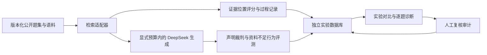

# 学有据 · 质量诊断工作台

实现日期：2026-10-12。沿用本机 FastAPI、原生前端和 SQLite。学习入口与私人讨论继续保留；实验只使用显式选定的公开题集，不读取账号讨论。

## 运行与入口

启动 `start.ps1`，以已有管理员账号登录，打开管理概览中的“质量诊断工作台”，或访问 `http://127.0.0.1:8765/diagnostics`。普通账号和匿名请求不能读取或写入实验接口；所有写操作复用原有 CSRF 与同源校验。

`output/experiments.sqlite3` 独立保存实验、检查点、调用预留和复核审计。其备份同样需要 SQLite backup 或在全部连接关闭后复制一致快照。不要把账号库、实验数据库、模型缓存或整份 output 目录上传到公开仓库。

```powershell
# 默认：30 道旧开发题、离线、零模型调用
.\.venv\Scripts\python.exe lab.py run --name baseline

# 三个受控消融；保存摘要与逐题配对报告
.\.venv\Scripts\python.exe scripts/run_ablations.py

# 可选向量环境；锁文件包含验证环境的完整依赖闭包
.\.venv\Scripts\python.exe -m pip install -r requirements-vector.lock
# 仅此显式命令允许下载 E5；缓存位于 output/vector-cache
.\.venv\Scripts\python.exe lab.py prepare-vectors --download
.\.venv\Scripts\python.exe scripts/run_ablations.py --vectors

# 查看、比较、回归（参数为实际运行产生的 ID）
.\.venv\Scripts\python.exe lab.py report <run-id> --out output/report.json
.\.venv\Scripts\python.exe lab.py compare <baseline-id> <candidate-id> --out output/comparison.json
.\.venv\Scripts\python.exe lab.py regress <baseline-id> <candidate-id>
.\.venv\Scripts\python.exe lab.py cancel <run-id>
.\.venv\Scripts\python.exe lab.py resume <run-id>

# 新题集草稿；结果显式标为含待复核题
.\.venv\Scripts\python.exe lab.py run --dataset agent-learning-v2 --allow-pending
```

回归命令在完整配对且没有检索要点覆盖退步时返回 0，否则返回 1。它只检查当前定义的检索回归，不代表生成、拒答、延迟或全业务验收通过。组别或评分实现不同的报告拒绝直接比较。

## 四个核心对象与数据流

| 对象 | 实现职责 |
| --- | --- |
| EvaluationDataset | schema v2 通用题集；保留 schema v1 的 40 题、五集合专属校验 |
| ExperimentRun | 配置、状态、数据/代码/依赖快照、进度、预留预算 |
| RagAdapter | 本地 BM25、E5、RRF；原文位置、候选排名与过滤过程 |
| Diagnostic | 声明、证据、判定、理由；规则、自动、人工来源分开 |



每次创建实验冻结题集字节哈希、语料版本、索引契约、所选题号、人工审批记录、模型名、提示词正文与哈希、检索/裁判版本、相关模块代码哈希和 Python/主要依赖版本。恢复前重新核对快照；变化后要求新建实验。模型服务端本身可能更新，所以保存原始请求、响应与实际使用量，重复实验按轮次分别报告。

## 检索实验

现有 v4 默认行为保持不变。实验开关独立控制邻接扩展、正文计分和意图筛选。每集合两条、总计八条证据的限制继续适用。

过程记录包含各集合被筛除的类型和数量、可排名片段数、前 20 个候选、原文区间及最终证据。BM25 分数只在其本集合统计下解释。E5 与关键词的混合采用每路前 20 个候选、常数 60 的 RRF 排名融合，不把两路原始分数直接相加。

E5 固定 `intfloat/multilingual-e5-small` 的提交 `5697a65b0a002a92fe8c4fc9d495303ffff9c7d2`，CPU 运行，query/passage 前缀和归一化向量。正文按 tokenizer 偏移切为最多 480 tokens、48 tokens 重叠的窗口，记录原文字符位置。长问题也按 480 tokens 截取，并在过程记录中标明。嵌入窗口用于召回；最终送入生成的证据仍按原文片段/邻接扩展规则组装。

缓存契约含原文版本、索引配置、正文遮罩哈希、模型版本与窗口策略；加载核对矩阵哈希、维度、有限数值及窗口位置。正文、分块、模型或遮罩变化使缓存失效。依赖或模型缺失时实验明确失败，不偷偷换成 BM25。

## 生成、声明裁判与控制实验

模式为 retrieval、generate、judge、oracle。后三者必须显式启用 `live`、调用次数和 token 预算；网页默认离线。模型与自动裁判均使用服务端 DeepSeek 配置，不影响普通用户的日额度。

生成沿用结构与引文出处校验。规则诊断即使发现引文真实，也只标“无法可靠判断”。自动裁判将复合要点拆成 `C1.1` 等原子声明，返回 supported、contradicted、insufficient 或 unjudgeable，附理由和本轮证据编号；支持/矛盾结论必须引用有效证据。insufficient 指当前证据不足，不表示事实在世界上为假。

另行评测回答覆盖的参考要点和完全资料不足题的拒答状态。缺少裁判结果的完整性指标为空；拒答状态匹配仍不等于拒答理由正确。自动声明拆解也会出错，必须通过校准题与人工审查发现误判。

oracle 模式使用人工标注的完整支持段落，保持相同问题、模型和教学提示词。若全部支持段落不能在现有证据限制内容纳，该题记录不可执行；部分可回答/资料不足题不构造充分证据。报告同时保留原检索证据与人工支持上下文。用普通生成和 oracle 结果配对提供归因证据，不凭单次差异声称已证明根因。

调用前事务预留次数与保守 token 数（输入 UTF-8 字节＋输出上限＋协议余量）。预留包含失败/未明调用，不声称它就是供应商账单。已完整落盘的响应恢复时重放；已预留却未完整落盘的调用不自动重试。预算耗尽后停止，新实验可使用更大预算。取消在本次操作结束后阻止后续操作。

真实实验示例（会产生费用，须自行选择预算）：

```powershell
.\.venv\Scripts\python.exe lab.py run --mode judge --live --call-budget 60 --token-budget 2000000 --repeat 1 --name generation-and-judge
.\.venv\Scripts\python.exe lab.py run --mode oracle --live --call-budget 60 --token-budget 2000000 --name oracle-control
```

## 100 题题集与人工复核

`agent-learning-v2.json` 含 60 开发、20 校准、20 保留题，同学习目标不跨分组。原 40 题继承 v1.1 已有人工原文标注；60 道新增题为阅读原文后编写的 AI 辅助草稿，**没有伪称已由人类验收**。五个改写组成同一学习目标，不能按 100 个独立主题解释样本量。

工作台可查看题面、参考要点、逐字支持段落和固定版本链接。维护者逐题确认后，审批以题集哈希绑定保存到实验库，不改动冻结 JSON。新建实验冻结当时审批状态；已有草稿实验不会因为后续审批变成已验收实验。题面或标注变动需要另建版本、重新静态校验及人工审批。

已生成回答的声明复核采用追加审计记录，保留自动判定、原证据、复核者和理由。校准报告只统计 calibration 分组的自动/人工配对，输出样本数、一致率和混淆矩阵；没有人工记录时一致率为空。开发题用于日常调参，保留题只用于显式阶段验收。

## 导入、恢复与 API

离线导入接受 `results` 数组，每项包含题号 `id`、可选 `answer` 与 `evidence`。证据须含 `source_id/start_char/end_char/context_text`，逐项核对实际原文及展示遮罩；来源链接由服务器生成。缺少 evidence 字段表示上下文不可观测，检索指标为空；显式空数组表示已观测到零证据。导入不读取外部路径、不执行 URL 或脚本，不做模型调用。

```powershell
.\.venv\Scripts\python.exe lab.py import output/report.json --dataset agent-learning-v1 --split dev
```

网页导入受现有 128 KiB 请求体上限约束，大报告使用 CLI。导入结果仅用于重放，不能恢复成新的检索任务。

主要接口在 `/api/lab/`：题集与审批、实验创建/列表/详情/导出、cancel/resume、声明复核、compare、import。每个数据库最多一个活动 worker，事务领取任务并定期续租；进程离线、租期到期后将未完成任务标为 interrupted，再由维护者恢复。每题每轮保存唯一检查点。数据库不会删除已有实验或覆盖私人讨论。

## 作品交付与验证入口

- `test_lab.py`：合成公开语料验证快照、标注、调用预算、恢复、导入、不确定性、裁判分歧、oracle、向量窗口与缓存、权限及 CSRF；模型均为离线替身。
- `scripts/run_ablations.py`：真实固定开发题的三项消融，加可选 E5/RRF 对照；不请求生成模型。
- `scripts/lab_preview.py`：临时账号库、公开实验重放、禁止真实模型调用的隔离浏览器环境。
- `scripts/check_lab_ui.js`：1440/390px、实验对比、题集审批和创建流程；使用 Playwright，模块与浏览器路径可通过环境变量覆盖。
- `scripts/record_lab_demo.js`：隔离预览的实际屏幕录制，包含检索失败、真实引用配构造错误结论、版本退步三个场景。构造回答明确标注为离线样例。

本次实现与实测结果见 `quality-lab-validation-2026-10-12.md`。生成事实正确性和自动裁判真实质量需要独立实测；本轮的代码测试、检索实验与演示视频不能代替这些验收。
